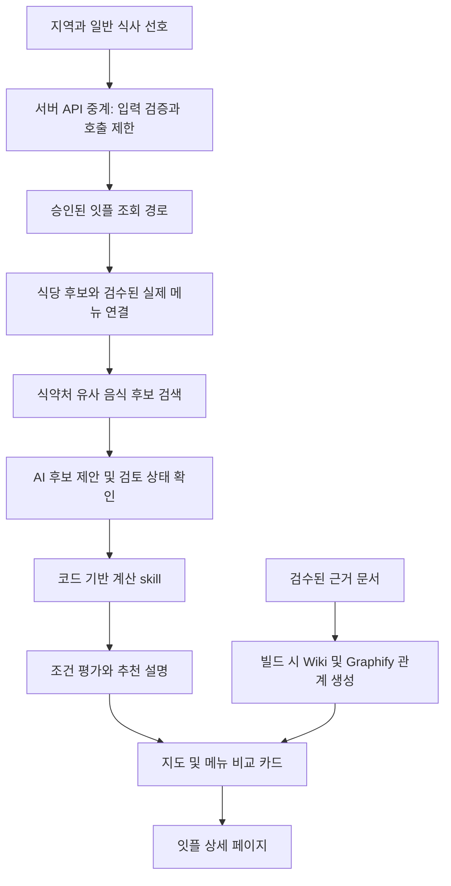

# 아키텍처

[문서 홈](../README.md) · 구현 전 설계 제안

## 처리 흐름

그래프는 개념적 흐름입니다. API·모델·지도 SDK 연동이 완료됐다는 뜻이 아닙니다.

## 구성요소

| 구성 | 책임 | 하지 않는 일 |
| --- | --- | --- |
| 반응형 웹 | 지도/목록, 선호 선택, 후보 비교, 근거 패널 | 비밀키 저장, 의료 판단 |
| 서버 중계 | 기관 인증정보 보호, 입력 검증, 총량·이용자별 제한, 오류 처리 | 무허가 API 프록시 이용 |
| 메뉴 매칭 | 실제 메뉴와 음식코드 후보 연결, 검토 상태 유지 | 이름만으로 레시피 확정 |
| 계산 skill | 기준량·단위·누락값 검사, 허용된 양 환산, 조건 평가 | LLM 출력에서 영양 숫자를 생성 |
| AI 어댑터 | 정제된 선호 해석, 후보 제안, 근거 기반 설명 | 전체 자연어 원문 전송, 근거 없는 수치 추가 |
| 정적 데이터 빌드 | 식약처 허용 데이터 정제, 검수 메뉴·문서·관계 버전 생성 | 잇플 응답의 무단 영구 DB화 |

여기서 skill은 테스트 가능한 도메인 기능 모듈을 뜻합니다. 특정 에이전트 제품이나 자동 도구 실행 권한은 아직 확정하지 않았습니다.

## 기술 선택 상태

- **사용자 선호:** Vercel 배포 우선, 월 추가 운영비 0원 목표.
- **제안:** 정적 화면 중심 웹 앱과 얇은 서버 API 중계. React/Vite 또는 Next.js 정적 구성을 비교할 수 있으나 프레임워크는 미확정입니다.
- **데이터 제안:** 작은 검수 데이터셋은 정적 JSON으로 시작합니다. 초기 벡터 DB·그래프 DB·사용자 계정 DB는 필수가 아닙니다.
- **AI·지도:** 공급자와 모델/SDK는 무료 조건·한국어 품질·표시 의무를 확인한 뒤 확정합니다.
- **대안:** Vercel 적격성이나 무료 기능이 맞지 않으면 Cloudflare Pages/Workers Free를 검토합니다.
- **핵심 제약:** 고정 송신 IP가 필요한 잇플 직접 API를 일반 무료 서버리스에서 호출할 수 있는지는 미확인입니다. 배포 전 승인된 경로를 확보해야 합니다.

## Wiki와 Graphify

Wiki에는 메뉴 매칭 근거, 음식 출처·기준일, 수정 이유를 기록합니다. Graphify가 문서에서 만든 관계는 검수 후보이며, 구조화된 검수 데이터가 숫자·사실의 기준입니다.

관계: `식당 → 실제 메뉴 → 매칭 음식코드 → 영양성분/기준량 → 출처/버전`.

사용자 요청마다 그래프를 다시 추출하지 않고 빌드 시 정적 문서와 관계 JSON을 생성합니다. 원천 자료의 저장·재배포 허가가 없는 데이터는 공개 그래프에 넣지 않습니다. 민감 사용자 선호를 공용 지식 그래프에 보관하지 않습니다.

## 실패 시 경로

- AI 실패/한도 소진: 선호 버튼과 검수된 설명으로 전환합니다.
- 매칭 불명확: 수동 검토 또는 평가 보류. 대체 음식의 숫자를 확정값으로 내보내지 않습니다.
- 지도 한도 소진: 허용된 식당 정보를 목록으로 보여줍니다.
- 잇플 실패: 새 조회가 불가능함을 알립니다. 캐시는 허가된 경우에만 확인 시점을 표시해 사용합니다.
- 메뉴 부족: 식당 정보만 제공하고 영양 추천 대상에서 제외합니다.

API 계약·추적 이벤트·캐시 TTL은 실제 이용 승인과 응답 검증 후 확정합니다. [데이터 정책](data-and-nutrition.md) · [무료 운영](operations.md).
